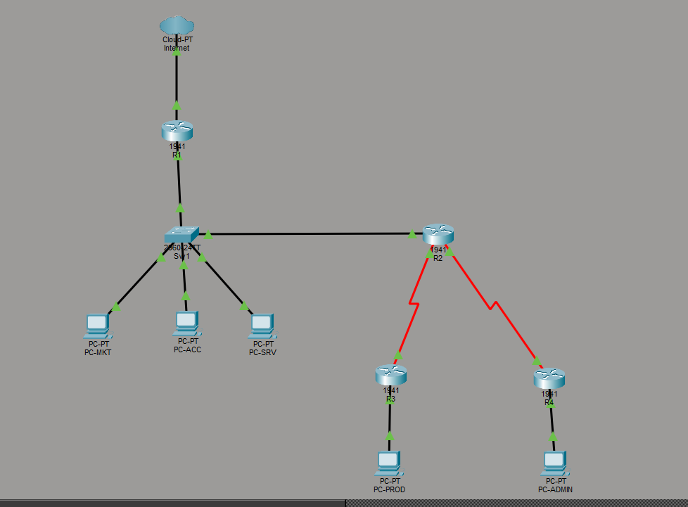

# Multi-Site Enterprise Network (Cisco Packet Tracer)

A multi-site network simulation built in Cisco Packet Tracer. It combines VLANs, inter-VLAN routing (router-on-a-stick), two dynamic routing protocols (RIPv2 and OSPF) with mutual redistribution, and NAT/PAT for Internet access.

> Academic project – Network Services module (Projet DS), class LIM 2 A

## Architecture

| Site | Devices | Role |
|------|---------|------|
| **HQ** | R1 (1941) | Edge router: default route to the ISP and PAT |
| **HQ** | Sw1 (2960-24TT) | Layer 2 switch with VLANs and an 802.1Q trunk |
| **HQ** | R2 (1941) | Core router: inter-VLAN routing, RIP↔OSPF redistribution |
| **Remote site 1** | R3 (1941) + PC-PROD | Production site, runs **RIPv2** |
| **Remote site 2** | R4 (1941) + PC-ADMIN | Administration site, runs **OSPF** (area 0) |
| **Internet** | Cloud-PT | Simulated Internet |

## VLANs (Sw1)

| VLAN | Name | Subnet | Gateway (R2) |
|------|------|--------|--------------|
| 10 | marketing | 192.168.10.0/24 | 192.168.10.1 |
| 20 | comptabilite | 192.168.20.0/24 | 192.168.20.1 |
| 30 | serveurs | 192.168.30.0/24 | 192.168.30.1 |
| 100 | lien-r1 | 192.168.100.0/30 | R1 = .1, R2 = .2 |

The trunk (Gig0/2 toward R2) allows VLANs 10, 20, 30 and 100.

## Links and remote LANs

| Link | Subnet | Addresses |
|------|--------|-----------|
| R1 ↔ ISP | 200.100.50.0/24 | R1 = 200.100.50.1, ISP = 200.100.50.2 |
| R2 ↔ R3 (serial) | 10.1.1.0/30 | R2 = .1, R3 = .2 |
| R2 ↔ R4 (serial) | 10.1.2.0/30 | R2 = .1, R4 = .2 |
| R3 LAN | 172.16.1.0/24 | Gateway 172.16.1.1, PC-PROD = 172.16.1.10 |
| R4 LAN | 172.16.2.0/24 | Gateway 172.16.2.1, PC-ADMIN = 172.16.2.10 |

The full IP addressing table is in the project report (`DS.pdf`).

## Implementation steps

1. **Layer 2 (Sw1):** create VLANs 10/20/30/100, assign access ports, configure the 802.1Q trunk toward R2.
2. **Inter-VLAN routing (R2):** router-on-a-stick with subinterfaces `Gi0/0.10`, `.20`, `.30`, `.100` (`encapsulation dot1Q`).
3. **WAN links:** two serial point-to-point /30 links from R2 to R3 and R4 (clock rate set on R2).
4. **Dynamic routing:**
   - R3 runs RIPv2 (`no auto-summary`).
   - R4 runs OSPF process 1, area 0.
   - R2 runs both protocols and redistributes each into the other (`redistribute rip subnets` in OSPF, `redistribute ospf 1 metric 5` in RIP).
5. **Default routing:** R2 → `192.168.100.1` (R1), R1 → `200.100.50.2` (ISP).
6. **NAT/PAT (R1):** `access-list 1` permits all internal networks, `ip nat inside source list 1 interface Gi0/1 overload`.
7. **DNS:** 8.8.8.8 configured on the hosts.
8. **Verification:** `show ip route`, `show ip protocols`, `show vlan brief`, `show interfaces trunk`, and ping tests between all sites.

## Verification results

| Test | Result |
|------|--------|
| Inter-VLAN ping (PC-MKT → VLAN 20) | ✅ |
| PC-MKT ↔ remote LANs (172.16.1.0/24, 172.16.2.0/24) | ✅ |
| PC-PROD ↔ PC-ADMIN (RIP site ↔ OSPF site, via R2) | ✅ (TTL 125) |
| RIP ↔ OSPF redistribution (routes visible on R3 and R4) | ✅ |
| Ping to 8.8.8.8 | ❌ 100% loss (see below) |

## Known limitations

- **Internet access is not working in this version.** The Cloud-PT device does not behave like a router (no IP stack, does not answer ICMP), so nothing answers at `200.100.50.2`. Replacing it with a router that has this address and a loopback `8.8.8.8` would allow a full end-to-end test.
- **R3 and R4 have no default route.** R2 does not advertise its default route into RIP/OSPF, so the remote sites cannot reach the Internet yet. Fix: add `default-information originate` under both `router rip` and `router ospf 1` on R2 (or static defaults on R3 and R4).
- **VLAN 30 (serveurs) has no access port assigned** in the final switch configuration.
- Security hardening is not done (default hostnames, no VTY passwords).

## Files

| File | Description |
|------|-------------|
| `Projet-DS.pkt` | Packet Tracer project |
| `DS.pdf` | Full report (configs, routing tables, ping tests) |
| `topology.png` | Network topology screenshot |

## How to open

Open `Projet-DS.pkt` with Cisco Packet Tracer.